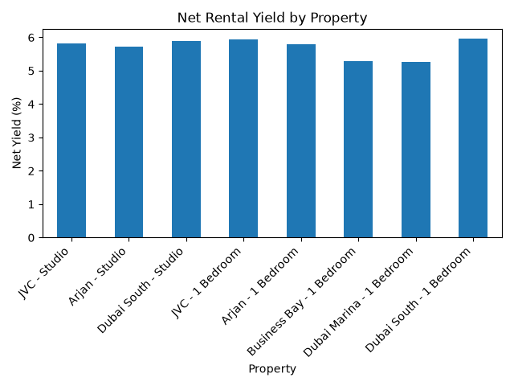
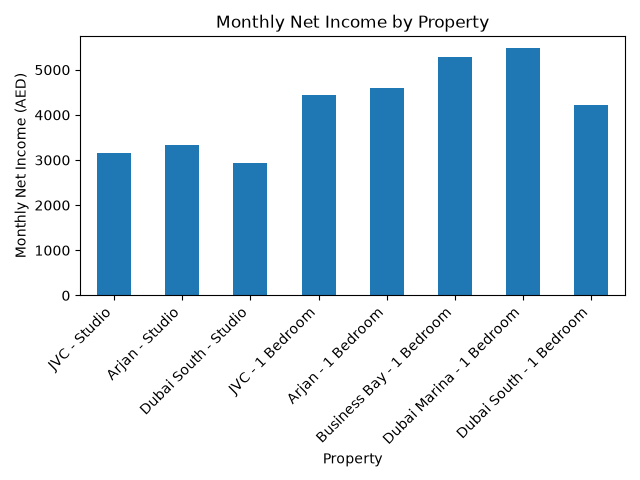
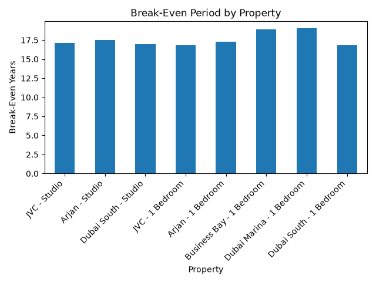

# UAE Real Estate Investment Analyzer

## Overview

This project analyzes sample UAE real estate investment opportunities using Python and Pandas.

The goal is to compare properties based on investment metrics such as:

- Gross rental yield
- Vacancy-adjusted rental income
- Annual expenses
- Net rental income
- Net rental yield
- Monthly net income
- Break-even period

The analyzer also identifies the best-performing property based on net rental yield.

## Technologies Used

- Python
- Pandas
- Matplotlib

## Project Structure

```text
uae-real-estate-analyzer/
│
├── data/
│   └── properties.csv
│
├── images/
│   ├── net_yield_by_property.png
│   ├── monthly_net_income.png
│   └── break_even_years.png
│
├── analyzer.py
├── visualization.py
├── README.md
├── requirements.txt
└── .gitignore
```

## Investment Metrics

The project calculates:

- Gross rental yield
- Vacancy loss
- Effective rental income
- Total annual expenses
- Net rental income
- Net rental yield
- Monthly net income
- Break-even period

## Key Findings

Based on the sample dataset:

- Dubai South 1 Bedroom produced the highest net rental yield.
- The best-performing property had a net yield of approximately 5.96%.
- Its estimated monthly net income was approximately AED 4,218.
- Its estimated break-even period was approximately 16.79 years.
- Higher rental income did not always result in a higher net yield because purchase prices and operating expenses differed.

## Visualizations

### Net Rental Yield by Property



### Monthly Net Income by Property



### Break-Even Period by Property



## How to Run the Project

Install the required libraries:

```bash
pip install -r requirements.txt
```

Run the investment analysis:

```bash
python analyzer.py
```

Generate the charts:

```bash
python visualization.py
```

## What I Learned

Through this project, I practiced:

- Loading and analyzing structured CSV data with Pandas
- Building financial calculations with Python
- Creating new calculated columns
- Comparing investment opportunities
- Using `idxmax()` and `.loc[]` to identify the best-performing property
- Working with vacancy rates and operating expenses
- Calculating gross and net rental yields
- Calculating break-even periods
- Creating comparison charts with Matplotlib
- Organizing a Python project into separate analysis and visualization files

## Note

The property values in this project are sample data created for educational and portfolio purposes. They do not represent live UAE property listings or investment advice.